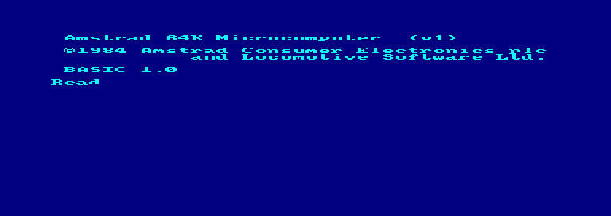
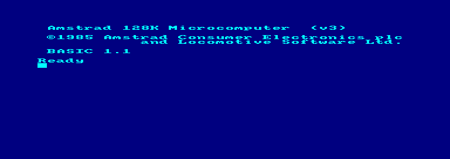
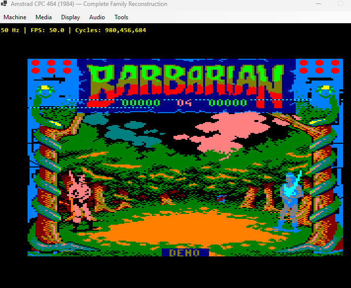
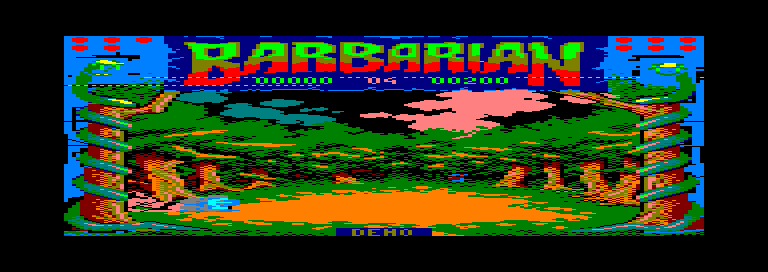
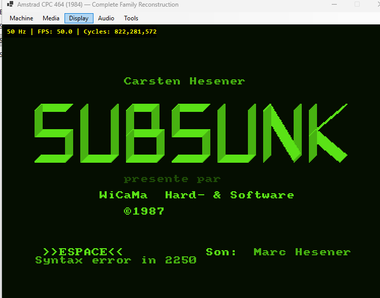

# Amstrad CPC Family (464 / 664 / 6128) | Hardware Reconstruction & Emulation

<div align="center">

[](https://github.com/ScientificBrad/amstrad-cpc-core/releases)
[](#building-and-running)
[](LICENSE)
[](docs/ARCHITECTURE.md)
[-success.svg?style=for-the-badge)](docs/TESTING.md)

**A cycle-accurate hardware reconstruction and real-time emulator for the complete Amstrad CPC microcomputer family (1984–1990).**  
*Featuring 4.0 MHz Zilog Z80A CPU, Amstrad Gate Array 40010/40007 memory contention and PAL timing, Hitachi HD6845 CRTC video, General Instrument AY-3-8912 3-channel audio synthesis, NEC µPD765 floppy disk controller with AMSDOS, authentic CDT cassette pulse streaming, and retail commercial game execution at locked 50 FPS.*

[Architecture](docs/ARCHITECTURE.md) • [Hardware Reference](docs/HARDWARE_REFERENCE.md) • [Testing](docs/TESTING.md) • [Reverse Engineering Archive](REA/README.md) • [Development Log](docs/DEVELOPMENT_LOG.md)

</div>

---

## Overview

This repository provides a clean-room software reconstruction and architectural emulator for the historic **Amstrad CPC** 8-bit personal computer family. Built from primary mask ROM reverse engineering, hardware schematics, and cycle-accurate execution models, it faithfully implements:

1. **Zilog Z80A CPU Core:** Cycle-accurate 4.0 MHz execution accounting for all official opcodes, prefixes (`CB`, `ED`, `DD`, `FD`, `DDCB`, `FDCB`), undocumented flag behaviors ($XF$, $YF$, $MEMPTR$), interrupt modes (IM 0, 1, 2), and non-maskable interrupts (NMI).
2. **Gate Array 40010 Memory Contention & Timing:** Strict 4-clock (1 MHz) memory access stretching to simulate genuine hardware contention arbitration, 52-scanline interrupt counters synchronized to CRTC VSYNC, and dynamic 27-colour hardware palette mapping.
3. **Hitachi HD6845 CRTC Video Controller:** Pixel-perfect rendering across Mode 0 (160×200, 16 colours), Mode 1 (320×200, 4 colours), and Mode 2 (640×200, 2 colours) with standard `$800` scanline memory interleaving and hardware screen base scrolling.
4. **General Instrument AY-3-8912 PSG Audio:** 3 tone channels with 12-bit period dividers, pseudo-random noise generator, 16-bit hardware envelope generator, 16-step logarithmic DAC, and real-time 44.1 kHz 16-bit PCM streaming via Windows WaveOut (`winmm.dll`) with dynamic ring-buffered latency pacing.
5. **NEC µPD765 Floppy Disk Controller & AMSDOS:** Complete MFM floppy disk engine supporting standard and extended `.DSK` disk images, geometry parsing, sector reading/writing, and AMSDOS firmware routines (`CAT`, `RUN"PROGRAM"`).
6. **Cassette Tape Subsystem:** Authentic hardware pulse-width modulation for `.CDT` and `.TZX` tape images, feeding digital transitions directly into Intel 8255 PPI Port B under motor relay control.
7. **Intel 8255 PPI & 10×8 Keyboard Matrix:** Bi-directional PSG bus protocol, CRTC VSYNC status monitoring, printer busy flags, and full keyboard matrix scanning with real-time graphical matrix debugging.
8. **Commercial Software Compatibility:** Verified cold boot and retail execution of flagship commercial titles including *Barbarian: The Ultimate Warrior* (1987, Palace Software), *Chase H.Q.* (1989, Ocean), *Subsunk* (1987), and *Stunt Car Racer* (1989).

---

## Visual Demonstration Gallery

### 1. Authentic Firmware Cold Boot (CPC 464 & CPC 6128)
Direct cold boot from unmodified factory mask ROMs into Locomotive BASIC 1.0 (CPC 464) and Locomotive BASIC 1.1 with AMSDOS 0.5 (CPC 6128):

<div align="center">
  
  
</div>

### 2. Commercial Game Execution: Barbarian: The Ultimate Warrior (1987)
Full high-colour Mode 0 raster graphics, authentic AY-3-8912 sword-clash audio, and interactive keyboard combat controls:

<div align="center">
  
  
</div>

### 3. Classic Software Suite: Subsunk (1987)
Testing French adventure title *Subsunk* on CPC 6128, verifying AMSDOS disk directory catalogues, character rendering, and green monitor emulation:

<div align="center">
  
</div>

---

## Architectural Block Diagram

```
       +---------------------------------------------------------------------------------+
       |                    AMSTRAD CPC FAMILY SYSTEM ARCHITECTURE                       |
       +---------------------------------------------------------------------------------+
                                                |
                                +----------------+----------------+
                                |         Zilog Z80A CPU          |
                                |           (4.00 MHz)            |
                                +----------------+----------------+
                                                |
                +-------------------------------+-------------------------------+
                |                               |                               |
         +--------------+                +--------------+                +--------------+
         |  64K/128K RAM|                | Lower ROM 16K|                | Upper ROM 16K|
         | &0000-&FFFF  |                | &0000-&3FFF  |                | &C000-&FFFF  |
         | (Bank Swapped|                | OS / Firmware|                | BASIC/AMSDOS |
         +--------------+                +--------------+                +--------------+
                |                                                                |
         +--------------+                +-----------------------------------------------+
         |  Gate Array  |                |               I/O Address Space               |
         |  40010/40007 |<==============>| &7Fxx: Gate Array (ROM/RAM bank, Pen colours) |
         | PAL/Interrupt|                | &BCxx/&BDxx: HD6845 CRTC (Address & Data)     |
         +--------------+                | &F4xx-&F7xx: Intel 8255 PPI (Port A, B, C)    |
                |                        | &FB7e/&FB7f: NEC µPD765 Floppy Controller     |
         +--------------+                +-----------------------------------------------+
         | HD6845 CRTC  |                               |
         | Video Timing |                +-------------------------------+
         | (Modes 0,1,2)|                |                               |
         +--------------+         +--------------+                +--------------+
                |                 | Intel 8255   |                |  AY-3-8912   |
         +--------------+         | PPI I/O Bus  |<==============>|  3-Ch Sound  |
         | Framebuffer  |         | (KBD/VSYNC)  |                | + 10x8 Matrix|
         | 50 FPS WinMM |         +--------------+                +--------------+
         +--------------+
```

---

## Supported Hardware Models

| Specification | CPC 464 (1984) | CPC 664 (1985) | CPC 6128 (1985) |
|---|---|---|---|
| **CPU** | Zilog Z80A @ 4.00 MHz | Zilog Z80A @ 4.00 MHz | Zilog Z80A @ 4.00 MHz |
| **RAM** | 64 KB Base RAM | 64 KB Base RAM | 128 KB (64 KB Base + 64 KB Banked) |
| **Firmware ROM** | OS 1.0 (16 KB) + BASIC 1.0 (16 KB) | OS 1.1 (16 KB) + BASIC 1.1 (16 KB) | OS 1.2 (16 KB) + BASIC 1.1 (16 KB) |
| **Floppy Subsystem**| Optional DDI-1 external | Built-in 3" FDD + AMSDOS ROM | Built-in 3" FDD + AMSDOS ROM |
| **Tape Interface** | Built-in Datacorder (CDT) | External DIN connector | External DIN connector |
| **Sound Synthesis**| AY-3-8912 (3 tone + 1 noise) | AY-3-8912 (3 tone + 1 noise) | AY-3-8912 (3 tone + 1 noise) |
| **Keyboard Layout**| 10×8 matrix (large Enter) | 10×8 matrix + cursor cluster | 10×8 matrix + numeric keypad |

---

## Building and Running

### Prerequisites
- [.NET 8.0 SDK](https://dotnet.microsoft.com/download/dotnet/8.0)
- Windows 10/11 (for Direct GDI+ video and WinMM audio output)

### Compile & Execute
```powershell
# Clone repository
git clone https://github.com/ScientificBrad/amstrad-cpc-core.git
cd amstrad-cpc-core

# Build entire solution
dotnet build

# Run automated hardware regression test suite (42 unit & integration tests)
dotnet test

# Launch interactive Windows emulator
dotnet run --project src/AmstradCPC.Emulator
```

---

## Subsystem Details

### Audio Subsystem (AY-3-8912 & WinMM WaveOut)
- **Clock Dividers:** 1.0 MHz master PSG clock derived from 4.0 MHz CPU $\div$ 4.
- **Logarithmic DAC:** Faithful 16-level logarithmic amplitude steps matching General Instrument hardware specifications.
- **Dynamic Pacing:** Symmetrically centered AC output coupled to a 16-slot circular buffer queue (`QueuedCount = 3..4`, 60–80 ms latency) eliminating crackle, buffer underruns, and DC offset pops.

### Video & Display Engine
- **Hardware Refresh:** Locked 50.0 Hz PAL video output with exact 79,872 cycle frame intervals.
- **CRTC Interleaving:** Authentic `$800` scanline memory address generator, CRTC R12/R13 dynamic screen base offset scrolling, and horizontal/vertical blanking.
- **Display Modes:** Mode 0 (160×200 16-color chunky), Mode 1 (320×200 4-color), Mode 2 (640×200 2-color), and border rendering.

### Keyboard & Diagnostic Tools
- **Full Matrix Emulation:** Faithful 10-row $\times$ 8-column hardware matrix accessed via AY-3-8912 Register 14 and PPI Port C.
- **Live Matrix Viewer:** Built-in graphical diagnostic inspector displaying real-time row/column assertions during gameplay and BASIC typing.
- **Configurable Controls:** Direct mapping for Enter, Space, directional arrows, and alphanumeric keys without numeric keypad prerequisites.

---

## License

This project is licensed under the [MIT License](LICENSE).
Firmware ROMs and commercial game images remain the copyright of their respective authors and publishers and are not distributed in this repository.
